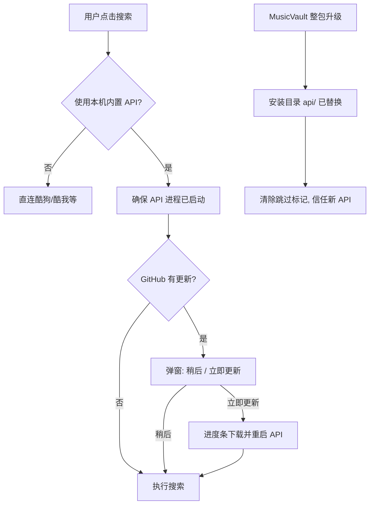

# MusicVault 分发说明

分发 zip 时建议在包根目录附带 `LICENSE`、`NOTICE`、`THIRD_PARTY_LICENSES.md`（可从仓库根目录复制）。用户须阅读 [LEGAL.md](LEGAL.md)。

## 别人没有 go-music-api 会怎样？

| 情况 | 行为 |
|------|------|
| **未配置**统一 API，且安装包**没有** `api/go-music-api.exe` | 自动使用**方案 B**：酷狗 / 酷我直连搜索（无需额外服务） |
| 安装包**带有** `api/go-music-api.exe` | 默认自动启动本地 API（`localhost:8080`），搜索更全 |
| 配置了远程 API 地址但服务未启动 | 统一 API 失败后**自动回退**到方案 B |

网易云仍需单独配置 NeteaseCloudMusicApi（可选）。

## 推荐分发方式（自带 API）

1. 在本机执行：

   ```powershell
   .\scripts\publish-with-api.ps1
   ```

   脚本会**先关闭**正在运行的 MusicVault，发布完成后再**自动启动**新版本。仅发布不启动可加 `-NoRestart`。

2. 将 `publish/win-x64-vol` **整个文件夹**打成 zip（不要只发单个 exe）。

目录结构：

```text
MusicVault/
  MusicVault.exe
  api/
    go-music-api.exe    ← 约 15–25 MB，随包附带
```

3. 用户解压后双击 `MusicVault.exe` 即可；首次会自动在后台启动 `api/go-music-api.exe`。

## 轻量分发（不带 API）

只发布 `MusicVault.exe`（及运行库文件）。用户在「发现」页选**酷狗**或**酷我**即可搜索，功能略少但零依赖。

## 偏好设置

- **统一音乐 API**：留空 = 不强制走 API；若目录内有 `api/go-music-api.exe` 且勾选自动启动，会默认使用 `http://localhost:8080`。
- **自动启动内置 api**：关闭后仅使用你填写的 API 地址，不会拉起本地 exe。

## 内置 API 更新策略（当前实现）



| 时机 | 行为 |
|------|------|
| **你发布新版 MusicVault** | `publish-with-api.ps1` 打入新 `api/go-music-api.exe` + `version.txt`；用户升级后主程序自动识别新版本并信任安装包内 API |
| **用户点搜索** | 先确保 API 在跑 → 每 6 小时最多查一次 GitHub → 有新版则弹窗（可「稍后」跳过该版本） |
| **用户点「立即更新」** | 对话框内进度条下载 → 替换 exe → 自动重启 API → 继续搜索 |

## 内置 API 要不要每次启动都检查更新？

**不建议。** 原因：

- 每次启动都联网检查会拖慢打开速度；
- 自动下载并替换 exe 有安全与杀毒误报风险；
- 新版 API 可能与当前 MusicVault 未一起测过，更适合和你发版绑定。

**推荐做法：**

| 方式 | 说明 |
|------|------|
| **随 MusicVault 发版更新** | 你发布新版本时运行 `publish-with-api.ps1`，把当时验证过的 API 打进 zip |
| **用户可选每周检查** | 偏好里勾选「每周后台检查…」→ 仅状态栏提示，不自动下载 |
| **用户手动更新** | 偏好 →「检查 API 更新」→「下载并安装更新」（从 GitHub Release 拉 `go-music-api_windows_amd64.zip`） |

启动时：**先用当前目录里的 API 跑起来**，更新检查在后台且可关闭。

## 自行构建 go-music-api

源码：<https://github.com/guohuiyuan/go-music-api>

```bash
go build -o go-music-api.exe .
```

将生成的 exe 复制到发布目录的 `api/` 下即可。
